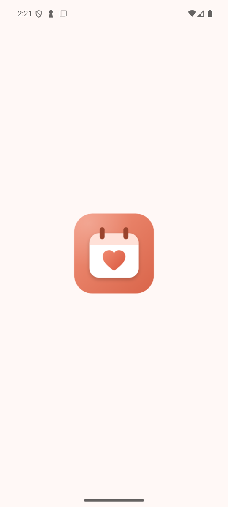
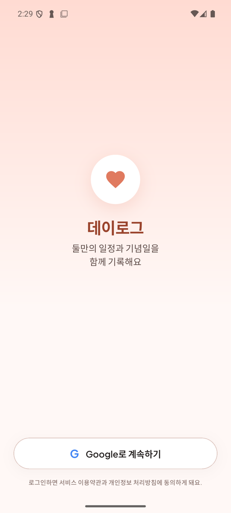
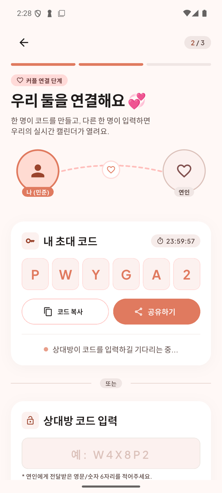
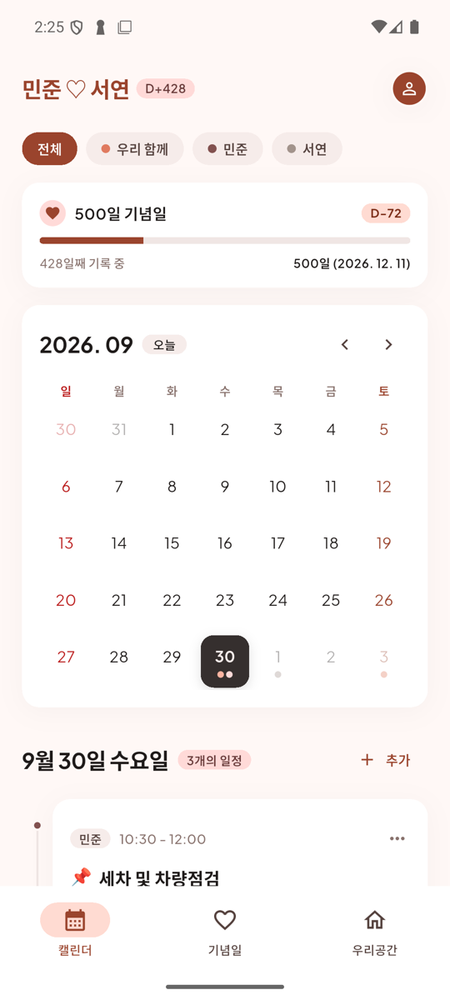
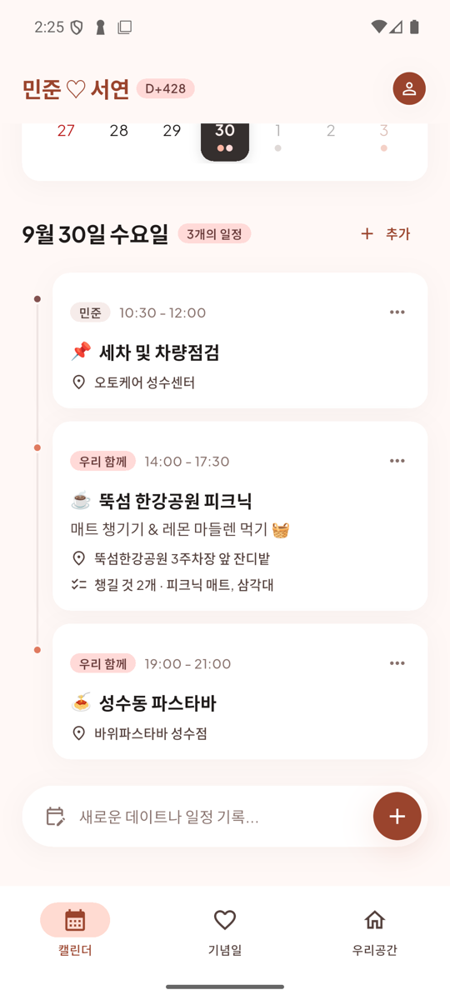
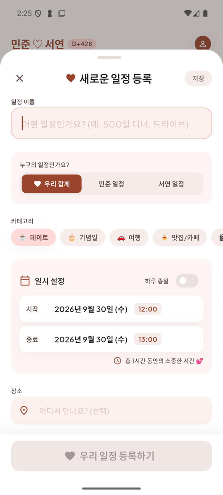
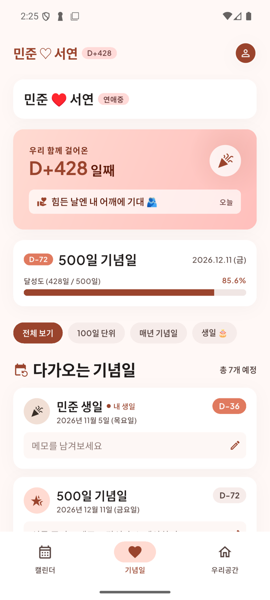
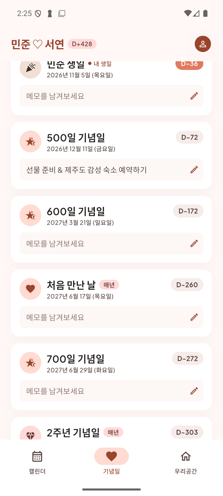
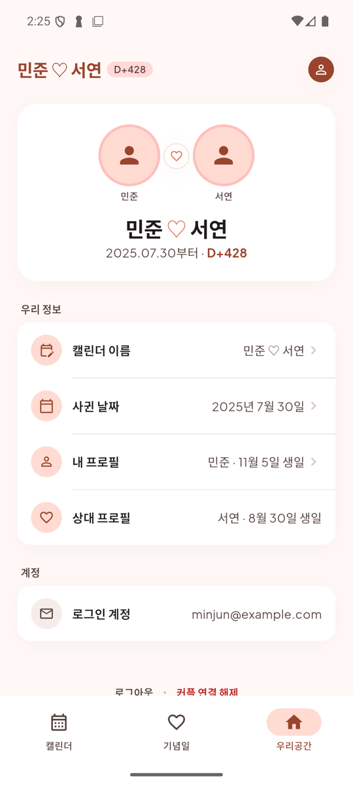

# 데이로그 (DayLog)

둘만의 일정과 기념일을 함께 기록하는 **커플 공유 캘린더** 앱입니다.
한 사람이 일정을 등록하면 상대방 화면에도 바로 나타나고, 사귄 날짜로 D-day와 100일·N주년·생일 같은 기념일을 자동으로 계산해 줍니다.

- 플랫폼: Android, iOS (Flutter)
- 백엔드: Firebase Authentication, Cloud Firestore
- 디자인: Google Stitch "Warm Modern Romantic" 디자인 시스템

---

## 스크린샷

| 시작 화면 | 로그인 | 커플 연결 |
|:---:|:---:|:---:|
|  |  |  |

| 캘린더 | 오늘의 일정 | 일정 등록 |
|:---:|:---:|:---:|
|  |  |  |

| 기념일 & D-Day | 다가오는 기념일 | 우리공간 |
|:---:|:---:|:---:|
|  |  |  |

> 스크린샷은 예시 데이터로 찍었습니다. 다시 찍으려면 [스크린샷 만들기](#스크린샷-만들기)를 참고하세요.

---

## 주요 기능

### 시작하기
- **Google 로그인**
- **온보딩 3단계**
  1. 내 프로필: 이름(애칭), 생일
  2. 커플 연결: 한 명이 6자리 초대 코드를 만들고(24시간 유효), 다른 한 명이 입력하면 연결됩니다.
  3. 사귄 날짜: 날짜를 고르면 D+일수와 다가오는 기념일을 바로 미리 보여줍니다.
- 상대가 코드를 입력하거나 사귄 날짜를 정하면 **두 폰이 동시에** 다음 화면으로 넘어갑니다.

### 캘린더
- 월간 캘린더에 일정 주인(우리 함께 / 나 / 상대)별 색 점 표시
- 주인별 필터 칩
- 선택한 날의 일정을 타임라인으로 보여줌: 시간, 장소, 메모, 챙길 것
- 일정 카드를 왼쪽으로 밀면 수정·삭제 (삭제는 한 번 더 확인)
- 일정 등록 시트 입력 항목
  - 이름, 누구의 일정인지, 카테고리
  - 시작·종료 날짜와 시간(여러 날 일정, 하루 종일 가능), 장소
  - 함께 챙길 것, 메모
- 다음 100일 기념일까지의 진행률 카드

### 기념일 & D-Day
- **자동 계산**: 100일 단위, N주년, 두 사람의 생일
- **직접 등록**: 이름·날짜·매년 반복 여부를 정해 추가
- 기념일마다 메모 (예: "선물 준비")
- 필터: 전체 / 100일 단위 / 매년 기념일 / 생일
- 매일 바뀌는 한 줄 글귀 46개. 두 사람이 같은 날 같은 글귀를 봅니다.

### 우리공간
- 커플 카드 (두 사람, 사귄 날짜, D+일수)
- 캘린더 이름 변경 (상단 헤더에 표시되고 두 사람에게 공유됨)
- 사귄 날짜 수정, 내 프로필 수정, 상대 프로필 보기
- 로그아웃, 커플 연결 해제

### 그 외
- 실시간 동기화: 일정, 기념일, 메모, 캘린더 이름
- 오프라인에서도 입력하면 화면에 먼저 반영되고, 연결되면 자동으로 올라갑니다 (Firestore 오프라인 캐시).
- 앱 아이콘, 네이티브 스플래시, 시작 애니메이션

---

## 기술 스택

| 영역 | 사용 기술 |
|---|---|
| 앱 | Flutter 3.47 / Dart 3.13 |
| 인증 | `firebase_auth`, `google_sign_in` 7 |
| 데이터 | `cloud_firestore` (실시간 구독 + 오프라인 캐시) |
| 캘린더 UI | `table_calendar` |
| 날짜·한국어 | `intl`, `flutter_localizations` |
| 공유 | `share_plus` (초대 코드 공유) |
| 폰트 | Plus Jakarta Sans (영문·숫자, 번들), 한글은 기기 기본 폰트 |
| 아이콘·스플래시 | `flutter_launcher_icons`, `flutter_native_splash` |
| 테스트 | `flutter_test`, `fake_cloud_firestore`, `firebase_auth_mocks` |

---

## 프로젝트 구조

```
lib/
├── main.dart                  # Firebase 초기화 → 스플래시 → 로그인 여부로 화면 분기
├── data/                      # Firebase 연동과 저장소
│   ├── auth_service.dart      #   Google 로그인 / 로그아웃
│   ├── couple_service.dart    #   프로필, 초대 코드, 커플 연결, 사귄 날짜, 캘린더 이름
│   ├── event_repository.dart  #   일정 (Firestore 실시간 구독 / 메모리 모드)
│   ├── anniversary_repository.dart  # 직접 등록한 기념일, 기념일 메모
│   └── daily_messages.dart    #   매일 바뀌는 글귀
├── models/                    # Event, Anniversary, UserProfile, Couple, CoupleProfile
├── screens/
│   ├── session_gate.dart      # Firestore 상태를 보고 온보딩 단계 또는 메인 화면을 고름
│   ├── onboarding/            # 1~3단계 화면
│   ├── home_shell.dart        # 하단 탭 (캘린더 / 기념일 / 우리공간)
│   ├── calendar_screen.dart
│   ├── anniversary_screen.dart
│   ├── account_screen.dart    # 우리공간
│   ├── login_screen.dart
│   └── splash_screen.dart
├── widgets/                   # 공통 UI (앱 바, 카드, 등록 시트, 로고 등)
└── theme/app_theme.dart       # 디자인 토큰 (색, 글꼴, 간격, 모서리, 그림자)

test/                          # 단위·위젯 테스트
tool/generate_brand_assets_test.dart  # 로고 PNG 생성 스크립트
firestore.rules                # Firestore 보안 규칙
```

### 화면 흐름

화면을 넘기는 코드 대신, `SessionGate`가 Firestore 문서를 실시간으로 구독하다가 상태에 맞는 화면을 보여줍니다.

```
로그인 안 됨           → 로그인 화면
프로필 없음           → 온보딩 1단계
커플 멤버가 2명 미만   → 온보딩 2단계 (초대 코드)
사귄 날짜 없음         → 온보딩 3단계
모두 있음             → 메인 (하단 탭)
```

두 폰이 같은 커플 문서를 구독하므로, 한쪽에서 코드를 입력하거나 날짜를 정하면 양쪽이 함께 다음 화면으로 넘어갑니다.

---

## 데이터 구조 (Firestore)

```
users/{uid}
  name, birthday("yyyy-MM-dd"), photoUrl, email, coupleId

couples/{coupleId}
  members[uid, uid], startDate("yyyy-MM-dd"), calendarName,
  inviteCode, inviteExpiresAt          # 상대가 합류하기 전까지만 있음
  ├── events/{eventId}
  │     title, date, owner("together" | uid), category,
  │     startTime("HH:mm"), endTime, location, memo, checklist[], createdBy
  ├── anniversaries/{id}
  │     title, date, repeatsYearly
  └── anniversaryMemos/{회차 id}        # 예: days-800, years-2, birthday-partner-2027
        text

invites/{code}
  coupleId, createdBy, expiresAt
```

- 날짜만 필요한 값(생일, 사귄 날, 일정 날짜)은 시간대 영향을 받지 않도록 문자열로 저장합니다.
- 일정의 주인은 `together` 또는 실제 uid로 저장합니다. 같은 일정이 두 사람 화면에서 각자 기준(나/상대)으로 올바르게 보이게 하기 위해서입니다.

### 보안 규칙 요약 ([firestore.rules](firestore.rules))
- **users**: 본인만 쓰고, 같은 커플의 상대는 읽기만 합니다.
- **couples**: 멤버 두 사람만 읽고 쓸 수 있습니다. 합류는 "만료 전인 1인 커플에 자기 자신만 추가"하는 경우만 허용합니다.
- **couples 하위 데이터** (일정, 기념일, 메모): 멤버 두 사람만 접근할 수 있습니다.
- **invites**: 코드를 아는 사람만 조회할 수 있습니다 (목록 조회 불가).

---

## 개발 환경 설정

### 필요한 것
- Flutter 3.47 이상
- Android: Android Studio (SDK, 에뮬레이터)
- iOS: Xcode, CocoaPods
- Firebase CLI (`firebase`), FlutterFire CLI (`flutterfire`)

### 실행
```bash
flutter pub get
flutter run                 # 연결된 기기나 에뮬레이터에서 실행
flutter run -d all          # 켜져 있는 모든 기기에서 실행
```

Firebase 설정 파일(`lib/firebase_options.dart`, `google-services.json`, `GoogleService-Info.plist`)은 저장소에 포함되어 있습니다. 들어 있는 API 키는 공개 식별자이고, 데이터는 보안 규칙으로 보호됩니다.

### Google 로그인 (Android)
Firebase 콘솔의 Android 앱에 서명 키의 **SHA-1**이 등록되어 있어야 합니다. 개발용 키는 등록되어 있습니다. 다른 PC에서 개발하거나 출시용 키를 만들면 그 SHA-1도 추가하세요.
```bash
keytool -list -v -keystore ~/.android/debug.keystore -alias androiddebugkey -storepass android -keypass android
```

### Firestore 보안 규칙 배포
```bash
firebase deploy --only firestore:rules --project calendar-47905
```

---

## 테스트

```bash
flutter test
```

| 파일 | 내용 |
|---|---|
| `couple_service_test.dart` | 프로필 저장, 초대 코드 발급·합류, 잘못된 코드(없음·내 코드·만료·사용됨), 연결 해제, 캘린더 이름 |
| `repository_sync_test.dart` | 두 사람 관점의 일정·기념일 동기화 (주인 변환, 삭제 전파, 커플 간 분리, 여러 날 일정) |
| `onboarding_flow_test.dart` | 로그인 후 프로필 → 코드 → 상대 합류 → 사귄 날짜 → 메인까지 전체 흐름 |
| `anniversary_test.dart` | 기념일 자동 계산, 필터, 등록·메모 |
| `widget_test.dart` | 캘린더 화면, 필터, 일정 등록, 밀어서 수정·삭제 |
| `daily_messages_test.dart`, `splash_test.dart` | 매일 글귀, 시작 애니메이션 |

Firebase는 `fake_cloud_firestore`와 `firebase_auth_mocks`로 대체해서, 실제 서버 없이 테스트합니다.

---

## 앱 아이콘 · 스플래시

로고는 [lib/widgets/app_logo.dart](lib/widgets/app_logo.dart)에 코드로 그려져 있습니다. 로고를 바꾼 뒤 아래를 실행하면 아이콘과 스플래시가 다시 만들어집니다.

```bash
flutter test tool/generate_brand_assets_test.dart   # assets/brand/*.png 생성
dart run flutter_launcher_icons                      # 앱 아이콘
dart run flutter_native_splash:create                # 네이티브 스플래시
```

---

## 스크린샷 만들기

[tool/screenshot_main.dart](tool/screenshot_main.dart)는 실제 Firebase 대신 가짜 데이터(민준·서연, 예시 일정·기념일)로 앱을 띄웁니다. 실제 계정이나 서버 데이터가 스크린샷에 나오지 않습니다.

```bash
# SCENE: main(메인 화면) | login | connect(초대 코드)
flutter run -t tool/screenshot_main.dart --dart-define=SCENE=main
```

같은 패키지 이름으로 설치되어 기존 앱을 덮어씁니다. 다 찍은 뒤에는 `flutter run`으로 원래 앱을 다시 설치하세요.

---

## 테스트 배포 (Firebase App Distribution)

1. [pubspec.yaml](pubspec.yaml)의 `version`에서 `+` 뒤 빌드 번호를 올립니다 (예: `1.0.0+2`).
2. 빌드하고 업로드합니다.
   ```bash
   flutter build apk --release
   firebase appdistribution:distribute build/app/outputs/flutter-apk/app-release.apk \
     --app 1:947686882101:android:a728c0cb9e6196ab632a7c \
     --project calendar-47905 \
     --testers "tester@example.com" \
     --release-notes "변경 내용"
   ```
3. 테스터는 초대 메일을 수락한 뒤 **Firebase App Tester** 앱에서 설치합니다.

> 릴리스 빌드는 아직 개발용 서명 키로 서명됩니다. Play 스토어 출시 전에 출시용 키를 만들고, 그 SHA-1을 Firebase에 등록해야 합니다.

## iOS 테스트 배포 (TestFlight)

App Store Connect 앱: **데이로그- 커플 캘린더** (번들 ID `com.junsupark.coupleCalendar`, 팀 `A255X3NN22`)

1. Android와 마찬가지로 `pubspec.yaml`의 빌드 번호를 올립니다. 같은 번호는 다시 올릴 수 없습니다.
2. 서명 없이 아카이브한 뒤, 내보낼 때 App Store 배포 인증서로 서명해 바로 업로드합니다.
   ```bash
   flutter build ios --release --no-codesign
   xcodebuild -workspace ios/Runner.xcworkspace -scheme Runner -configuration Release \
     -destination generic/platform=iOS -archivePath build/ios/archive/Runner.xcarchive \
     archive CODE_SIGNING_ALLOWED=NO
   xcodebuild -exportArchive -archivePath build/ios/archive/Runner.xcarchive \
     -exportPath build/ios/ipa -exportOptionsPlist ios/ExportOptions.plist \
     -allowProvisioningUpdates
   ```
3. 처리(수 분~30분)가 끝나면 App Store Connect → TestFlight에서 테스터 그룹에 빌드를 추가합니다.

> - 팀에 등록된 아이폰이 없어 `flutter build ipa`는 개발용 프로필을 만들지 못해 실패합니다. 기기를 등록하면 `flutter build ipa`로도 됩니다.
> - 이 Mac의 키체인에 **Apple Distribution** 인증서가 있어야 합니다. 처음 서명할 때 키체인 허용 창이 뜨면 "항상 허용"을 누릅니다.

---

## 보안 주의

다음 파일은 `.gitignore`로 커밋되지 않게 막혀 있습니다.
- `.env`, 서명 키(`*.jks`, `*.keystore`, `key.properties`)
- 서비스 계정 키, 인증서(`*.p8`, `*.p12`, `*.pem`)
- 로컬 도구 설정(`.claude/settings.local.json`, `.mcp.json`)

토큰이나 비밀 키는 커밋하지 마세요.

---

## 앞으로 할 일
- [ ] 위시/메모 탭 (디자인은 Stitch에 있음, 탭은 주석 처리됨)
- [ ] 기념일을 캘린더 화면에도 표시
- [ ] 프로필 사진 변경 (Firebase Storage)
- [ ] 알림 (기념일·일정 리마인드)
- [ ] Apple 로그인 (App Store 출시 전 필수)
- [ ] 출시용 서명 키와 스토어 배포
